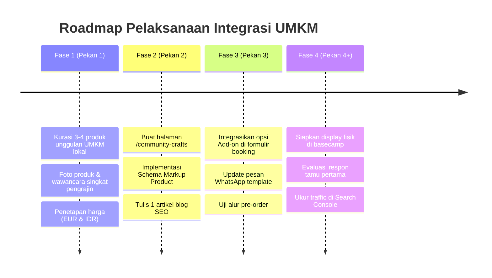

# Rencana Strategis Integrasi Produk UMKM Lokal — Orangutan Adventure Sumatra
**Dokumen Panduan Riset, Pemasaran, SEO, dan Implementasi Teknis**  
*Terakhir diperbarui: 7 Oktober 2026*

---

## 1. Ringkasan Eksekutif & Tujuan Bisnis

Program **"Bukit Lawang Community Shop & Trek Add-ons"** bertujuan untuk mengintegrasikan produk-produk UMKM lokal (kopi, kerajinan, minyak herbal, perlengkapan trekking) ke dalam platform **Orangutan Adventure Sumatra**.

Inisiatif ini dirancang bukan sebagai *toko online e-commerce internasional konvensional* (yang terbebani ongkos kirim global mahal dan logistik rumit), melainkan sebagai **Community-Based Ecotourism (CBET) Experience & Trek Add-on Model**.

### Tujuan Utama:
1. **Meningkatkan Nilai Transaksi per Wisatawan (Average Order Value / AOV)**: Memberikan opsi add-on pada pemesanan tur jungle trekking.
2. **Dampak Sosial Nyata (Community Empowerment)**: Membuka akses pasar langsung bagi petani kopi, penjahit wanita, dan perajin bambu lokal di Bukit Lawang dan sekitarnya.
3. **Memperkuat Diferensiasi & Brand Positioning**: Menegaskan komitmen bisnis terhadap pariwisata berkelanjutan dan etis yang disukai wisatawan Eropa.
4. **Memperluas Jangkauan Organik (SEO)**: Menangkap kata kunci pencarian seputar oleh-oleh lokal, suvenir etis, dan kopi Sumatra tanpa mengaburkan otoritas pencarian tur utama.

---

## 2. Analisis Target Audiens & Riset Perilaku (Buyer Persona)

### A. Karakteristik Wisatawan (Pasar Eropa & Internasional)
* **Demografi**: Wisatawan dari Belanda, Jerman, Prancis, Inggris, dan negara Eropa lainnya.
* **Motivasi Belanja**:
  * Menghindari produk suvenir pabrikan/impor massal plastik.
  * Ingin tahu siapa yang membuat produk tersebut (*storytelling* & *fair trade*).
  * Mencari produk yang memiliki fungsi langsung untuk trekking atau oleh-oleh yang mudah dibawa pulang.
* **Hambatan Utama (Friction)**:
  * **Kapasitas Ransel**: Wisatawan trekking membawa barang terbatas di *backpack*. Produk harus berbobot ringan atau ringkas.
  * **Ongkir Internasional**: Mengirim barang fisik dari Bukit Lawang ke Eropa menelan biaya $40–$70/paket. Model *e-commerce shipping global* tidak realistis bagi UMKM lokal tahap awal.
  * **Karantina Makanan/Tumbuhan**: Makanan segar dilarang masuk bandara Eropa/Australia, namun kopi sangrai kering bersegel (*roasted coffee beans*) diizinkan.

### B. Solusi Model Bisnis: "Pre-Order on Booking & Basecamp Pick-Up"
* **Bukan kirim ke luar negeri**, melainkan disiapkan saat wisatawan tiba di Bukit Lawang atau selesai trekking.
* Wisatawan memilih produk saat memesan tur di website (`/booking`) atau saat konfirmasi WhatsApp.
* Barang diserahkan langsung di guesthouse/basecamp, dikemas rapi dalam tas kanvas/kain ramah lingkungan.

---

## 3. Kurasi Produk UMKM (Product-Market Fit Matrix)

| Kategori | Produk Spesifik | Profil Pengrajin/UMKM | Nilai Jual bagi Turis | Estimasi Harga (€) |
| :--- | :--- | :--- | :--- | :--- |
| **Specialty Coffee** | Sumatra Leuser / Karo Roasted Coffee Beans (200g - Biji/Bubuk) | Petani & roaster lokal lereng Gunung Leuser / Tanah Karo | Kopi Sumatra terkenal di dunia. Kemasan bersegel rapat, tahan lama, legal dibawa masuk pesawat internasional. | €6 – €9 |
| **Jungle Care & Health** | Minyak Karo Tradisional & Natural Citronella Spray (Serai Wangi) | Pengrajin herbal tradisional keluarga di Bahorok | Obat gigitan serangga dan pelindung nyamuk alami hutan hujan, non-kimia keras, ramah lingkungan. | €4 – €7 |
| **Eco Trek Gear** | Handmade Leech Socks (Kaos Kaki Anti Lintah) & Sarung Botol Anyaman | Kelompok penjahit wanita di desa sekitar Bukit Lawang | Sangat fungsional saat trekking di musim hujan, mencegah lintah masuk celana, dapat dicuci ulang. | €5 – €8 |
| **Art & Keepsakes** | Bamboo Straws berukir + Pouch Kain Batik lokal | Perajin bambu lokal Bukit Lawang | Ringan, bebas sampah plastik, suvenir kenang-kenangan dengan ukiran nama atau motif orangutan. | €3 – €5 |
| **Community Package** | **"The Jungle Trekker Eco-Care Kit" (Bundle)**: Citronella Spray + Leech Socks + Kopi 100g + Bamboo Straw | Kolaborasi UMKM gabungan | Praktis, solusi sekali klik saat melakukan booking tur. | **€18 – €22** |

---

## 4. Strategi SEO & Arsitektur Konten

### A. Arsitektur Informasi & URL
Agar tidak mengganggu otoritas domain sebagai operator jungle trekking, struktur direktori dibuat terpisah dan saling mendukung:

* **Halaman Showcase / Etalase**:
  * URL: `https://orangutanadventuresumatra.com/community-crafts` (atau `/support-local`)
  * Canonical: Self-canonical
  * Target Intent: *Informational + Commercial Investigation* (wisatawan yang ingin tahu apa yang bisa dibeli untuk mendukung warga lokal).
* **Artikel Blog Pilar (Traffic Attractor)**:
  * URL: `https://orangutanadventuresumatra.com/blog/ethical-souvenirs-bukit-lawang-sumatra`
  * Judul: *"What Souvenirs to Buy in Bukit Lawang: Guide to Ethical & Community-Made Gifts"*
  * Target Intent: Menjaring pencarian turis yang sedang merencanakan liburan di Sumatra.

### B. Riset Kata Kunci (Keyword Targets)

| Target Keyword | Volume / Intent | Peruntukan Halaman |
| :--- | :--- | :--- |
| `ethical souvenirs bukit lawang` | Niche / High Intent | `/community-crafts` |
| `what to buy in north sumatra` | Informational | Blog Article |
| `authentic sumatra coffee bukit lawang` | High Intent | Blog & Product Showcase |
| `bukit lawang local community projects` | Informational / Brand Trust | `/community-crafts` & About |
| `leech socks bukit lawang trekking` | High Intent | Add-on & Equipment FAQ |

### C. Implementasi Schema Markup (Structured Data)
Gunakan kombinasi Schema `Product`, `Offer`, dan `LocalBusiness`:

```json
{
  "@context": "https://schema.org",
  "@type": "Product",
  "name": "Artisan Sumatra Roasted Coffee Beans (Leuser Origin)",
  "image": "https://orangutanadventuresumatra.com/images/products/sumatra-coffee.webp",
  "description": "Locally grown and roasted Arabica coffee from the Leuser ecosystem, packaged by community farmers in North Sumatra.",
  "offers": {
    "@type": "Offer",
    "priceCurrency": "EUR",
    "price": "8.00",
    "availability": "https://schema.org/PreOrder",
    "seller": {
      "@type": "LocalBusiness",
      "name": "Orangutan Adventure Sumatra"
    }
  }
}
```

---

## 5. Strategi Pemasaran & Funnel Konversi (CRO)

### Funnel 1: Trek Add-On saat Booking (Konversi Tertinggi)
Wisatawan yang telah memutuskan untuk memesan paket 2 hari atau 3 hari sudah berada dalam *buying mode*. Menambahkan produk bernilai €10–€20 terasa kecil dibandingkan total biaya tur €100–€300.
* **Eksekusi di `app/booking/booking-form.tsx`**:
  * Tambahkan section: *"Support Local Communities & Enhance Your Trek"*
  * Checkbox interaktif:
    * `[ ] Add Jungle Care Kit (Citronella Spray + Leech Socks) (+€12)`
    * `[ ] Add Sumatra Artisan Coffee Pack (200g Whole Beans) (+€8)`
  * Data add-on otomatis masuk ke dalam teks permintaan ketersediaan dan pesan WhatsApp.

### Funnel 2: Storytelling di Halaman `/community-crafts`
Wisatawan internasional membeli *cerita di balik produk*, bukan sekadar barang:
* Tampilkan foto profil nyata pengrajin (misal: "Ibu Nurhayati — Ketua Kelompok Penjahit Desa Bahorok").
* Cantumkan keterangan transparansi: *"100% of product revenue directly benefits the artisan and local conservation fund"*.
* Tombol CTA: *"Reserve for Pick-up via WhatsApp"*.

### Funnel 3: Touchpoint Pasca-Trek (Post-Trek Souvenir)
Banyak tamu jatuh cinta dengan pengalaman trekking dan ingin membawa kenang-kenangan sebelum pulang ke Medan/bandara:
* Sediakan display etalase fisik kecil di titik kumpul/basecamp Bukit Lawang.
* Berikan QR Code yang mengarah ke ulasan Google Review dan katalog produk lokal.

---

## 6. Rencana Implementasi Teknis (Next.js 15)

1. **Struktur Data Baru (`app/content/community-products.ts`)**:
   * Definisikan array objek produk: `id`, `name`, `artisanName`, `story`, `priceEur`, `priceIdr`, `category`, `image`, `weightGrams`.
2. **Halaman Baru (`app/community-crafts/page.tsx`)**:
   * Tampilan visual elegan mengikuti `DESIGN.md` (warna `field-paper`, `forest`, `canopy-ink`, aksen `signal`).
   * Desain kartu produk dengan cerita pengrajin, badge ramah lingkungan, dan tombol pesan via WhatsApp.
3. **Modifikasi Formulir Booking (`app/booking/`)**:
   * Menambahkan state pilihan add-on pada `BookingForm`.
   * Memperbarui kalkulasi ringkasan pemesanan secara dinamis.
4. **Artikel Blog Edukasi (`app/blog/ethical-souvenirs-bukit-lawang-sumatra/`)**:
   * Panduan komprehensif tentang oleh-oleh ramah lingkungan dan cara mendukung ekonomi lokal.
5. **Update Navigasi & Sitemap**:
   * Menambahkan tautan "Community Crafts" di `StaticFooter` atau submenu tanpa mengacaukan navigasi utama tur.
   * Daftarkan URL baru di `app/sitemap.ts`.

---

## 7. Roadmap Pelaksanaan Bertahap



---

## 8. Metrik Keberhasilan (KPI)

1. **Tingkat Adopsi Add-on (Booking Conversion)**: Minimal 15–25% pemesan tur memilih setidaknya 1 add-on produk lokal saat reservasi.
2. **Kenaikan Nilai Transaksi Rata-rata**: Peningkatan pendapatan sebesar €10 – €30 per grup pemesan.
3. **SEO Impressions & Clicks**: Artikel blog dan halaman produk mulai mendapatkan impresi di Google Search Console untuk kueri suvenir dan kopi lokal dalam 60–90 hari.
4. **Kepuasan Tamu**: Ulasan positif di Google Review yang menyebutkan kebaikan dan manfaat perlengkapan lokal (misal: *"the homemade leech socks saved my trek"*).
